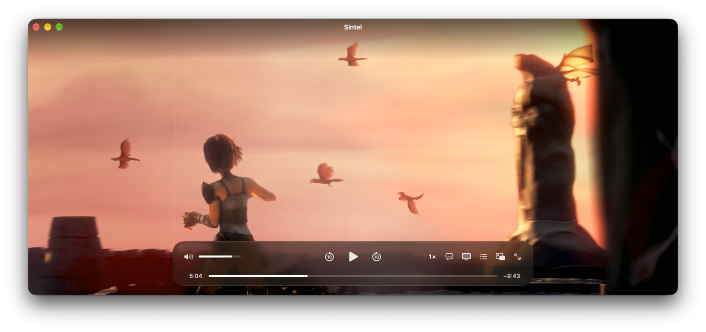
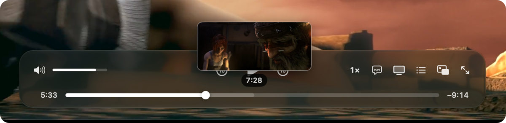
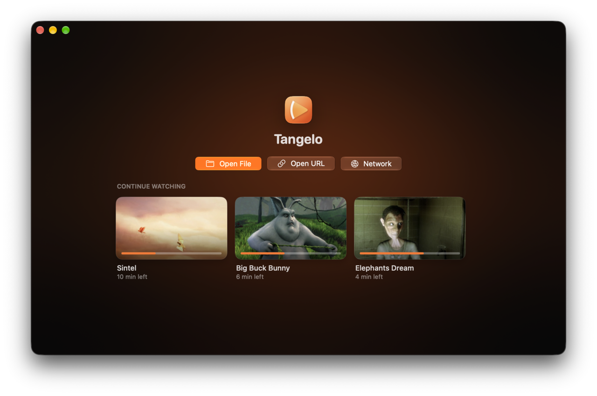

<p align="center">
  
</p>

<h1 align="center">Tangelo</h1>

<p align="center"><strong>A modern Mac media player, powered by VLC's playback engine.</strong></p>

Tangelo plays the files and streams VLC plays (MKV, AVI, HEVC, AV1, FLAC, network shares and more) in an
interface designed for the Mac from scratch. Under the hood it uses **libVLC**, the same engine that runs inside VLC
media player. Everything you see and touch is new.

> **Tangelo is an independent project.** It is not VLC, not a fork of VLC, and not affiliated with or endorsed by
> VideoLAN. It uses VideoLAN's open source libVLC library, which they publish for exactly this purpose.

**Status:** early development. There are no signed downloads yet, so for now you [build it from source](#build-from-source).
Requires macOS 15 or later on Apple silicon or Intel.

<p align="center">
  
</p>

---

## What you get

### Plays almost anything

- **Video:** MKV, MP4, MOV, AVI, WebM, MPEG-TS/M2TS, WMV, FLV, OGG and more, with H.264, HEVC, AV1, VP9, MPEG-2
  and the long tail of older codecs. Hardware decoding through VideoToolbox where the Mac supports it.
- **Audio:** FLAC, Opus, AAC, MP3, ALAC, Vorbis, WAV, AC-3, DTS and more, with album art and tags.
- **Subtitles:** embedded tracks plus external SRT, ASS/SSA (full styling), WebVTT, VobSub and TTML files.
- **Streams and shares:** HTTP, HLS, DASH, RTSP, UDP/RTP, SMB, NFS, SFTP and FTP.

All of this comes from libVLC. If VLC 3 can play it, Tangelo almost certainly can.

### An interface that gets out of the way

- Edge-to-edge video with glass controls that fade when you stop moving the mouse.
- The window sizes itself to the video. Full screen and a **mini player** that floats over other apps and snaps to
  screen corners.
- **Seek previews:** hover the seek bar to see the frame at that point.
- Trackpad gestures: swipe to scrub, swipe up or down for volume, pinch for full screen.

<p align="center">
  
</p>

### Picks up where you left off

- **Continue Watching** on the welcome screen, with thumbnails and time left.
- Long videos resume where you stopped.
- **Series aware:** open `Show S01E03.mkv` and the rest of the season is queued, with an Up Next countdown at the end.

<p align="center">
  
</p>

### Your TV and your network

- **Chromecast:** cast anything Tangelo can play. libVLC converts the stream on the fly when the TV needs it.
- **AirPlay:** for MP4, MOV and M4V files (see [the AirPlay note](#what-vlc-does-that-tangelo-doesnt-yet) below).
- **Network browser:** finds shared folders (SMB) and media servers (DLNA/UPnP) on your network, with logins saved to
  your Keychain.

### Feels like part of macOS

- Control Center's Now Playing, the play/pause key and AirPods controls all work.
- Your display stays awake while video plays.
- Open files from Finder, drag them onto the window, or paste a URL.

---

## Tangelo and VLC

### How they fit together

| Comes from VLC's engine (libVLC) | Built by Tangelo |
| --- | --- |
| Decoding every format and codec | The entire user interface, written in SwiftUI |
| Hardware-accelerated decoding | Continue Watching, resume points and series queueing |
| Subtitle rendering | Seek previews and the mini player |
| Network protocols and streaming | The network browser and login prompts |
| Chromecast output and transcoding | AirPlay handoff to Apple's player |
| Share and media server discovery | Now Playing, media keys and sleep handling |

Tangelo talks to libVLC through **VLCKit**, VideoLAN's official framework for Apple platforms (currently VLCKit
3.7.3, built on libVLC 3.0.x). The app downloads that exact VLCKit release from VideoLAN when you build it, and ships
it unmodified inside the app.

### Why not just fork VLC?

VLC's Mac interface is a separate layer on top of libVLC. Making it look modern means rewriting that layer anyway,
and a fork would then have to merge VLC's very large codebase forever. Building a new app on libVLC is the approach
[IINA](https://iina.io) takes with mpv: the engine stays VideoLAN's job, and the experience becomes this project's
job.

### What VLC does that Tangelo doesn't (yet)

Being honest about the gaps:

- **DVD and Blu-ray discs.** Disc menus and encrypted discs aren't supported. Plain video files ripped from discs play
  fine. (The library VLC uses to decrypt DVDs is deliberately left out; it's legally risky in the US.)
- **AirPlay for every format.** AirPlay uses Apple's own player, which only handles MP4, MOV and M4V. For MKV, AVI and
  others, use Chromecast or play them on this Mac.
- **Converting, recording and streaming out.** VLC's convert/save and streaming server features have no interface here.
- **Effects and tinkering.** No equalizer, video filters, skins, extensions or the advanced preferences tree.
- **Windows and Linux.** Tangelo is Mac-only for now. The code is structured so other platforms can be added later.

If you need any of those, VLC is excellent and Tangelo installs happily alongside it.

### Updates to the engine

Fixes to libVLC, including security fixes, reach Tangelo when the project moves to a newer VLCKit release. The
pinned version lives in `scripts/fetch-vlckit.sh`.

---

## Using Tangelo

| Key | Action |
| --- | --- |
| Space | Play / pause |
| ← / → | Back / forward 5s (⇧ for 30s, ⌘ for 10s) |
| ↑ / ↓ | Volume |
| F | Full screen |
| M | Mute |
| N | Next in playlist |
| ⌘O / ⌘L | Open file / open URL |
| ⌘[ / ⌘] | Slower / faster |
| ⇧⌘P | Playlist |
| ⇧⌘N | Browse network |
| ⌥⌘M | Mini player (Esc to leave) |
| ⌥⌘T | Float on top |

Click the video to pause and double-click for full screen. Drop files on the window to play them; with the playlist
open, dropped files are added to it instead. On a trackpad, swipe left or right to scrub, swipe up or down for volume,
and pinch for full screen. A mouse wheel changes volume.

---

## Build from source

You need Xcode 26 or later and [XcodeGen](https://github.com/yonaskolb/XcodeGen) (`brew install xcodegen`).

```bash
git clone https://github.com/tomlynch/tangelo.git
cd tangelo
./scripts/fetch-vlckit.sh   # downloads VLCKit 3.7.3 from VideoLAN and verifies its checksum
xcodegen generate
open Tangelo.xcodeproj
```

Then build and run the Tangelo scheme. On macOS 26 and later the controls use Liquid Glass; on macOS 15 they use
translucent materials.

---

## License

- **Tangelo's own code** is under the [MIT License](LICENSE): use it, change it, ship it, sell it, in open or closed
  projects. Keep the copyright notice and license text with copies. It comes with no warranty.
- **libVLC and VLCKit** are VideoLAN's, licensed under the LGPL 2.1 or later. Tangelo ships them as a separate,
  unmodified framework inside the app, which you're free to replace with your own build. The bundled build contains
  no GPL-only components; details and source links are in [THIRD_PARTY_NOTICES.md](THIRD_PARTY_NOTICES.md).
- **Screenshots** show *Sintel*, *Big Buck Bunny* and *Elephants Dream*, © Blender Foundation
  ([blender.org](https://www.blender.org)), licensed [CC BY 3.0](https://creativecommons.org/licenses/by/3.0/).
- **Trademarks:** "VLC", "VideoLAN" and the VLC cone are VideoLAN's trademarks. Tangelo uses the name only to
  describe its engine and doesn't use the logo. Tangelo's name and icon are its own.

---

## Contributing

### Layout

| Path | What lives there |
| --- | --- |
| `Tangelo/Engine/` | The only code that imports VLCKit: `Player` (playback model), `VideoSurface`, `Thumbnails`, `SeekPreviews`, `Casting`, `NetworkBrowser`, `DialogHandler`, plus `AirPlay` (AVFoundation) and the VLCKit-free `EpisodeQueue`, resume points and recents |
| `Tangelo/App/` | App entry, menus, window chrome (auto-hide, fit-to-video, full screen, mini player), keyboard and trackpad input, `SystemIntegration` (Now Playing, media keys, sleep prevention) |
| `Tangelo/Views/` | SwiftUI views: control bar, welcome screen, playlist and network panels, Play On menu, now-playing, Up Next |
| `scripts/` | `fetch-vlckit.sh` (pinned VLCKit download) and `make-icon.sh` (icon export) |
| `design/icon/` | Icon source: `generate.py` writes `Tangelo.svg`; tweak it there, then run `scripts/make-icon.sh` |
| `docs/screenshots/` | README screenshots, taken from a separate build with its own bundle ID so personal settings never appear |
| `footage/` | Open movies for screenshots and testing (git-ignored; sources in `footage/README.md`) |

`Tangelo --open <path>` opens a file at launch, `--network` opens the network browser and `--mini` starts in the
mini player. These exist for scripted screenshots.

### Rules worth keeping

- **VLCKit stays inside `Engine/`.** Views talk to `Player`, never to VLCKit, so a Windows or Linux shell only needs
  a new engine against libVLC's C API.
- **Only time displays read `Player.elapsed`.** It changes several times a second. `TimelineRow`, `MiniProgressBar` and
  `UpNextCard` read it; everything else reads stored, slower-changing state (`showsUpNext`, `hasStartedPlayback`), so
  playback doesn't re-render the window or the control bar's buttons and menus.
- **libVLC callbacks never mutate the queue directly.** Changing media inside a libVLC event can deadlock; hop to
  the next main-actor turn first (see `reachedEnd()` in `Player`).
- **End of file arrives as a pause.** VLCKit 3 pauses on the last frame instead of reporting `.ended`, so `Player`
  treats an unrequested pause in the final 1.5s as the end. Keep that in mind before touching state handling.
- **AirPlay is AVPlayer, not libVLC.** libVLC has no AirPlay video output, so `AirPlay` keeps an AVPlayer loaded
  with the current item and `Player` hands transport to it (`ExternalTransport`) while an AirPlay route is active.
  Only formats AVFoundation plays natively qualify. Chromecast goes through libVLC renderers and handles everything.
- **The mini player is the same window.** libVLC can't move its video output to another view mid-playback, so mini
  mode shrinks and pins the main window rather than opening a second one.
- **libVLC discovery and dialog callbacks have no thread guarantee.** `NetworkBrowser` polls while visible,
  `Casting` and `DialogHandler` hop to the main thread themselves.
- **Thumbnailer callbacks can arrive off the main thread.** `ThumbnailJob` is the only VLCKit delegate that isn't
  main-actor; keep it that way.
- **Don't copy code or art from VLC's own interface modules.** They are GPL and would make Tangelo GPL.

### Releasing (LGPL checklist)

1. Set your Development Team, then archive, sign with a Developer ID, notarize, and ship as a DMG. Release builds use
   the hardened runtime, which only loads VLCKit when the app and framework share a Team ID; an unsigned (ad-hoc)
   Release build won't launch. For a local unsigned Release build, pass `ENABLE_HARDENED_RUNTIME=NO`.
2. Attach the matching VLCKit source archive (VLCKit tag `3.7.3` from code.videolan.org) to the GitHub release.
   LGPL-2.1 section 6 requires the library's source to be offered alongside the binary.
3. Keep `VLCKit-COPYING.txt` and `THIRD_PARTY_NOTICES.md` in the app bundle (the build does this).

### Roadmap

- Signed, notarized releases with automatic updates
- AirPlay for MKV/AVI (needs live remux to HLS) and true Picture in Picture (VLCKit 4)
- Subtitle styling and delay controls, audio delay, equalizer
- Chapters in the seek bar
- Move to VLCKit 4 once it leaves alpha (better HDR and Picture in Picture)
- Windows (WinUI 3 + LibVLCSharp) and Linux (GTK4/libadwaita + libVLC) versions reusing the same design
